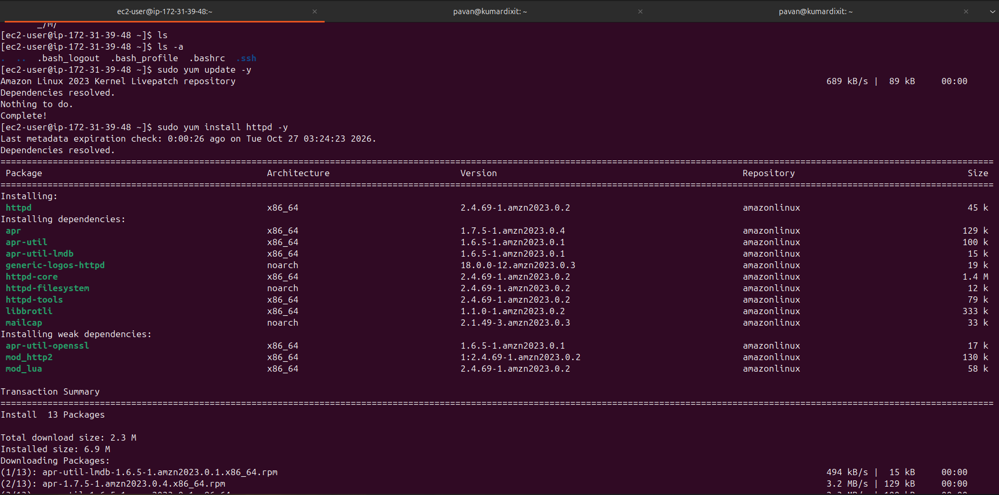
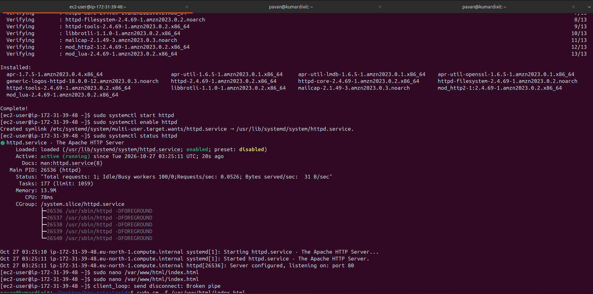
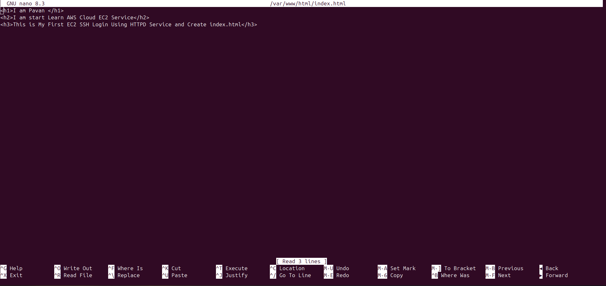
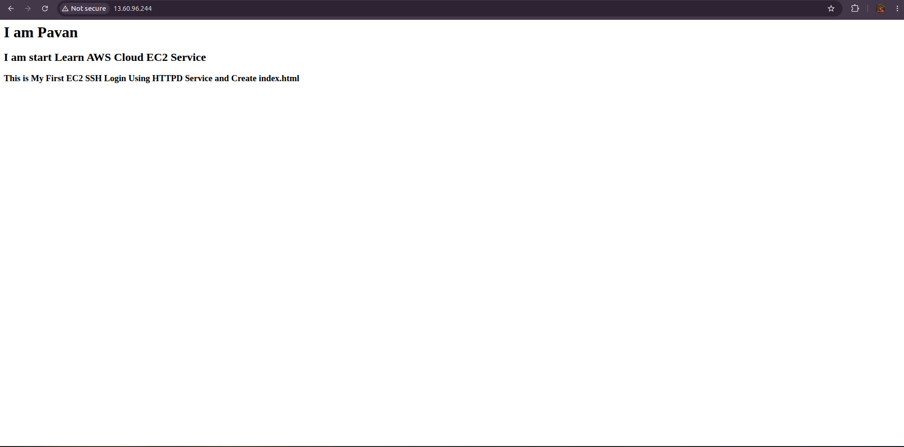
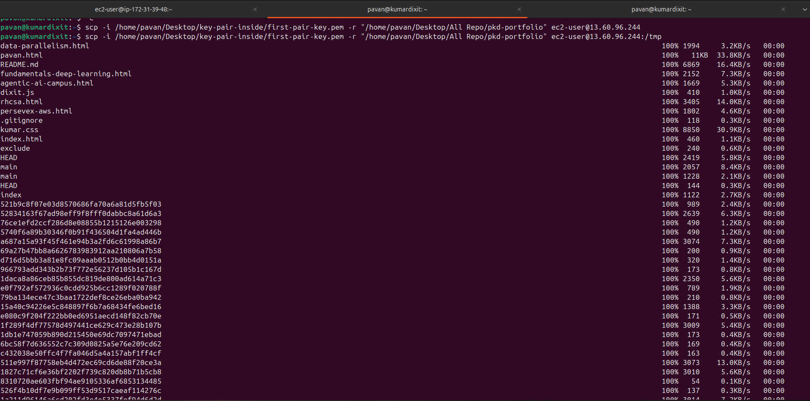
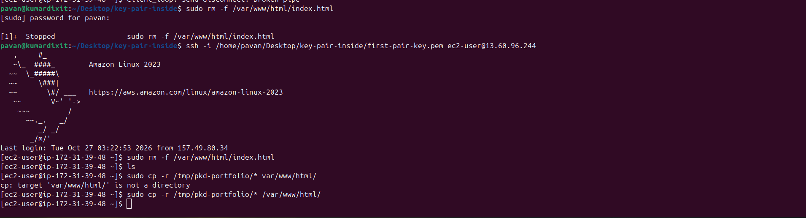
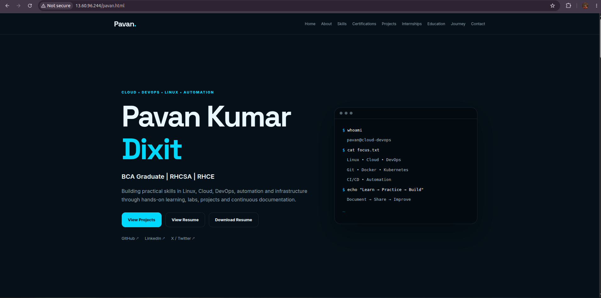

# Deploy a Static Website on AWS EC2 Ubuntu

A hands-on project demonstrating how to launch a static website on an AWS EC2 instance, install Apache, transfer a local HTML/CSS/JavaScript project using `scp`, and publish the site through the instance's public IPv4 address.

## 🎯 Project Goals

- Connect to an EC2 instance over SSH.
- Install and manage Apache on Ubuntu.
- Create and test a basic HTML page.
- Transfer a complete static website from a local Ubuntu machine to EC2.
- Publish the website from Apache's document root.
- Verify the deployment using a browser.

## 🧰 Technologies

- AWS EC2
- Ubuntu Linux
- Apache HTTP Server
- SSH and SCP
- HTML, CSS, JavaScript
- Nano text editor

## 📁 Repository Structure

```text
.
├── README.md
├── httpd-install/
│   ├── httpd-install-ec2.png
│   ├── httpd-start-ec2.png
│   ├── index_html.png
│   └── outpust-index_html-ec2.png
├── index.html
├── script.js
├── static-images/
│   ├── first-static-in-ec2.png
│   ├── output-static_website-ec2.png
│   ├── transfer-local-ec2.png
├── style.css
└── Guide-httpd.md
```

> The structure above includes the main files you provided. If `Guide-httpd.md` is not present in this project folder, remove that line or update the tree to match your actual repository. Keep screenshot names and capitalization exactly as they exist.

## ⚠️ Important: Ubuntu Uses `apt` and `apache2`

For an **Ubuntu EC2 instance**, use `apt` to install packages and `apache2` as the Apache service name. The commands `yum` and `httpd` are generally for Amazon Linux and other RHEL-family distributions, not Ubuntu.

## 1. Connect to the EC2 Instance

From your local Ubuntu terminal, use your private key and the EC2 public IPv4 address:

```bash
chmod 400 /path/to/your-key.pem
ssh -i /path/to/your-key.pem ubuntu@YOUR_PUBLIC_IP
```

Replace `/path/to/your-key.pem` and `YOUR_PUBLIC_IP` with your actual values. Ubuntu EC2 images commonly use the username `ubuntu`.

## 2. Update Ubuntu Packages

After SSH login, run:

```bash
sudo apt update
sudo apt upgrade -y
```

`apt update` refreshes package information, while `apt upgrade -y` installs available package upgrades.

## 3. Install Apache

```bash
sudo apt install apache2 -y
```

Apache serves website files from the default document root:

```text
/var/www/html/
```

## 4. Enable, Start, and Check Apache

Enable Apache at boot:

```bash
sudo systemctl enable apache2
```

Start Apache now:

```bash
sudo systemctl start apache2
```

Or enable and start it in one command:

```bash
sudo systemctl enable --now apache2
```

Check the service status:

```bash
sudo systemctl status apache2
```

Look for `active (running)`. Press `q` to exit the status view.

### Screenshot: Install Apache



### Screenshot: Start and verify Apache



## 5. Create a Test HTML Page

Open the default index file:

```bash
sudo nano /var/www/html/index.html
```

Add this sample content:

```html
<!DOCTYPE html>
<html lang="en">
<head>
    <meta charset="UTF-8">
    <meta name="viewport" content="width=device-width, initial-scale=1.0">
    <title>My First EC2 Website</title>
</head>
<body>
    <h1>Welcome to My AWS EC2 Website!</h1>
    <h2>Apache is Running on Ubuntu</h2>
    <p>This page is hosted on an Amazon EC2 instance.</p>
    <p>Next step: deploy a complete static website.</p>
</body>
</html>
```

Save in Nano with `Ctrl + O`, press `Enter`, then exit using `Ctrl + X`.

Verify the page from the EC2 instance:

```bash
curl http://localhost
```

### Screenshot: Edit `index.html`



## 6. Allow HTTP Traffic in the EC2 Security Group

For the site to be accessible from your browser:

1. Open **AWS Console → EC2 → Instances**.
2. Select your instance and open its **Security** tab.
3. Click the attached security group.
4. Choose **Edit inbound rules**.
5. Add or verify this rule:

| Type | Protocol | Port | Source |
|---|---|---:|---|
| HTTP | TCP | 80 | `0.0.0.0/0` for a public website |

Save the rule. `0.0.0.0/0` allows HTTP requests from any IPv4 address, so use it only if the website is meant to be public. For private testing, restrict the source as appropriate.

Also ensure the instance has a reachable public IPv4 address and its subnet/network settings permit inbound traffic.

## 7. Test the Basic Website

Copy the instance's **Public IPv4 address** from the EC2 console. Open a browser and visit:

```text
http://YOUR_PUBLIC_IP
```

Replace `YOUR_PUBLIC_IP` with the actual address.

You should see the heading **Welcome to My AWS EC2 Website!**

### Screenshot: Basic Website Output



## 8. Transfer Your Local Static Website to EC2 Using SCP

Open a **new terminal on your local Ubuntu computer**. Do not run the following SCP command inside the EC2 SSH session.

Assume your local project contains:

```text
Static-Site-EC2/
├── index.html
├── script.js
├── style.css
└── static-images/
```

Run the command below, replacing the key path, local project path, and public IP:

```bash
scp -i "/path/to/your-key.pem" -r "/path/to/Static-Site-EC2/." ubuntu@YOUR_PUBLIC_IP:/tmp/Static-Site-EC2/
```

This copies the project contents, including the HTML, CSS, JavaScript, and images, to `/tmp/Static-Site-EC2/` on the EC2 instance.

**Important:**

- Use `ubuntu@YOUR_PUBLIC_IP` for a standard Ubuntu EC2 AMI.
- Use `ec2-user@YOUR_PUBLIC_IP` only for an AMI whose default SSH username is `ec2-user`, such as Amazon Linux.
- The local path must match your actual project directory.
- The remote `/tmp/Static-Site-EC2/` directory must exist or be created before transfer. If needed, create it first from the EC2 terminal:

  ```bash
  mkdir -p /tmp/Static-Site-EC2
  ```

If you create the directory after starting the transfer, run the SCP command again.

### Alternative: Copy the Project Folder

You can also copy the entire local project directory:

```bash
scp -i "/path/to/your-key.pem" -r "/path/to/Static-Site-EC2" ubuntu@YOUR_PUBLIC_IP:/tmp/
```

This alternative creates `/tmp/Static-Site-EC2/` when the copy succeeds. Choose one SCP approach and use its matching destination path in the next steps.

### Screenshot: Transfer Local Project to EC2



## 9. Copy the Website Files into Apache's Document Root

Reconnect to the EC2 instance if needed:

```bash
ssh -i "/path/to/your-key.pem" ubuntu@YOUR_PUBLIC_IP
```

Inspect the transferred files:

```bash
ls -la /tmp/Static-Site-EC2/
```

Back up the current default page before replacing it:

```bash
sudo cp /var/www/html/index.html /var/www/html/index.html.bak
```

Copy the website files to Apache's document root:

```bash
sudo cp -r /tmp/Static-Site-EC2/. /var/www/html/
```

The `/.` source copies the directory contents, including hidden files if present, rather than creating an extra nested project directory.

If your website's HTML, CSS, JavaScript, and images are in the expected locations, Apache can now serve them from `/var/www/html/`.

### Important: Do Not Delete the Index File First

You do not need to remove `/var/www/html/index.html` before copying your project. Copying your project's `index.html` over the default page replaces it. Backing up the old file first is safer than running `sudo rm -f`.

If you intentionally want to remove a file, verify its exact path before doing so. The correct path is `/var/www/html/index.html`, not `/var/www/html.index.html`.

## 10. Verify the Deployed Website

Check the files in Apache's document root:

```bash
ls -la /var/www/html/
```

Check Apache status:

```bash
sudo systemctl status apache2
```

Test the local web server:

```bash
curl -I http://localhost
```

Then return to your browser and refresh the existing tab, or open a new tab and visit:

```text
http://YOUR_PUBLIC_IP
```

You should now see your own static website, including the styling and JavaScript, provided the relative file paths in the HTML are correct.

### Screenshot: Website Deployed on EC2



### Screenshot: Final Website Output



## 11. Troubleshooting

### Browser cannot connect

- Confirm the EC2 instance is running.
- Confirm inbound TCP port 80 is allowed by the security group.
- Check that Apache is running:

  ```bash
  sudo systemctl status apache2
  ```

- Verify the public IPv4 address and network routing.

### The old page still appears

- Confirm the files were copied into `/var/www/html/`.
- Verify the contents of `/var/www/html/index.html`.
- Refresh the browser and, if needed, try a private window.

### CSS, JavaScript, or images are missing

- Confirm `style.css`, `script.js`, and the image directory were transferred.
- Check the relative paths in `index.html`.
- Make sure the assets are inside the Apache document root at the paths referenced by the HTML.

### SCP fails

- Check the local `.pem` key path.
- Ensure the key has secure permissions, for example `chmod 400`.
- Verify the SSH username and public IP.
- Confirm SSH port 22 is allowed from your trusted IP.
- Ensure the remote destination directory exists.

## 🔐 Security and Cost Notes

- Restrict SSH access to your trusted IP instead of allowing port 22 from everywhere.
- HTTP uses unencrypted traffic. For production, configure HTTPS with a domain and certificate.
- Do not place secrets, private keys, or credentials in the public web root.
- EC2 compute, EBS storage, public IPv4 addresses, and data transfer may incur charges. Review AWS Billing and Cost Management and stop or terminate resources when no longer needed.

## 🧠 What I Learned

- Connecting to EC2 Ubuntu with SSH.
- Installing and managing Apache using `apt` and `systemctl`.
- Creating a custom HTML page with Nano.
- Configuring security group rules for HTTP.
- Transferring a local website using SCP.
- Deploying HTML, CSS, JavaScript, and images to Apache's web root.
- Verifying a live static site using a public IPv4 address.

## 👨‍💻 Author

**Pavan Kumar Dixit**

This project is part of my hands-on learning in **AWS Cloud Computing, Linux, and DevOps**.
